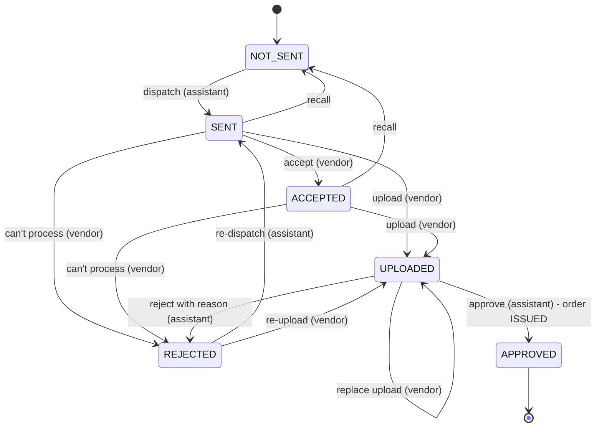

# Vendor workflow

Manual fulfilment mode only (`ESTAMP_FULFILMENT=manual`). A **VENDOR** is an external stamping partner
created by Master Admin (`/vendors`). Vendors have no organization and see only the orders sent to them.

## Flow

1. A client request leaves its 20-minute window, locks and is charged (unchanged).
2. The organization's assigned Assistant Master Admin (or a Master Admin) **dispatches** orders to a vendor
   (`POST /orders/dispatch`, up to 200 at a time, per-order results).
3. The vendor **accepts**, stamps outside the app, and **uploads** each certificate with its stamp reference,
   one by one. A re-upload supersedes the previous pending file (history kept).
4. The assistant **reviews**: *approve* runs the same issue step as manual fulfilment and releases the
   certificate to every client user of the organization; *reject* (with a reason) sends it back for re-upload.

The existing manual fulfil and mark-failed actions remain as fallbacks at any point.

## `EStampOrder.vendorStatus`

Mark failed (any stage before APPROVED) sets the order FAILED and the vendor stage back to NOT_SENT.

| From | Action | Actor | To |
|---|---|---|---|
| NOT_SENT / REJECTED | dispatch | assistant / Master Admin | SENT |
| SENT, ACCEPTED | recall | assistant / Master Admin | NOT_SENT |
| SENT | accept | vendor | ACCEPTED |
| SENT, ACCEPTED, REJECTED, UPLOADED | upload | vendor | UPLOADED |
| SENT, ACCEPTED, REJECTED | can't process | vendor | REJECTED (`vendorDeclined`, uploads blocked until re-dispatch) |
| UPLOADED | approve | assistant / Master Admin | APPROVED (order ISSUED) |
| UPLOADED | reject (reason) | assistant / Master Admin | REJECTED |
| any open stage | mark failed | assistant / Master Admin | NOT_SENT (order FAILED) |

Upload history (`vendorUploads[]`): each entry is `PENDING`, then `SUPERSEDED` (replaced), `REJECTED`
(with `reviewNotes`) or `APPROVED`. At most one entry is `PENDING`; every file is kept.

## Safety rules

- Vendors and clients can never mark anything ISSUED. Only approval (or manual fulfil) creates the
  `EStampDocument` that the client download path requires. Unapproved vendor files are stored as
  `ESTAMP_DOCUMENT` assets, so they never appear in a client's supporting documents.
- Ledger, reservation, charge and refund rules are untouched; mark failed keeps its optional single reversal.
- A VENDOR is fenced in `authenticate` to `/vendor/*`, `/auth/*`, `/notifications`, `PATCH /profile` and
  policy acknowledgement; every other route is 403. Every `/vendor` lookup is scoped to `vendorId = me` (404 otherwise).
- The vendor projection carries no charged amount, wallet, payment, contact, user or other-organization data.
- Clients never see the vendor's identity, vendor statuses or vendor audit events; the timeline keeps
  "Being prepared by LauncherDesk".
- Every dispatch, recall, accept, upload, decline, reject, approve and failure is audited with the real actor.
